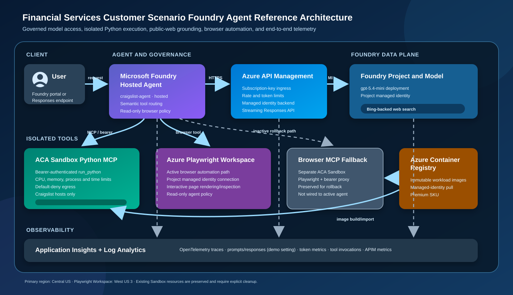
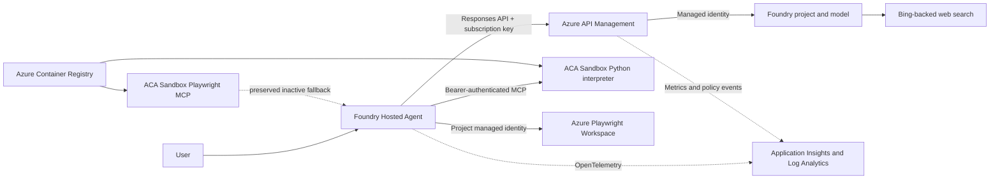

# Financial Services Customer Scenario Foundry Agent Reference Architecture

This repository deploys a complete Microsoft Foundry Hosted Agent reference
architecture with Terraform. It demonstrates governed model access through
Azure API Management (APIM), isolated Python execution in Azure Container Apps
(ACA) Sandbox, current public-web grounding, browser automation through Azure
Playwright Workspace, and end-to-end OpenTelemetry observability.

> [!IMPORTANT]
> This is a working engineering reference, not a production security baseline.
> Foundry Browser Automation and ACA Sandbox include preview surfaces as of
> September 2, 2026. Review networking, data protection, capacity, retention,
> identity, and operational controls before using this design with production
> or confidential data.

## Deployed environment

| Item | Deployed value |
|---|---|
| Subscription | `Private Test Sub ACAPMS` |
| Resource group | `ss-agent-day3` |
| Primary region | `centralus` |
| Playwright region | `westus3` |
| Foundry account | `ss-day3-ai-bhcvln` |
| Foundry project | `ss-day3-project` |
| Hosted Agent | `craigslist-agent`, version 4 |
| Model deployment | `gpt-5.4-mini` |
| APIM | `ss-day3-apim-bhcvln` |
| Playwright Workspace | `ss-day3-pw-bhcvln` |
| Playwright connection | `playwright-automation` |

Open the deployed agent in
[Microsoft Foundry](https://ai.azure.com/nextgen/r/MFAcbIH2QayjiNKc9DoCDQ,ss-agent-day3,,ss-day3-ai-bhcvln,ss-day3-project/build/agents/craigslist-agent/build?tid=72f988bf-86f1-41af-91ab-2d7cd011db47&version=4).

## Architecture



The source-level view is:



### Components

| Component | Responsibility |
|---|---|
| Foundry account and project | Own the model deployment, Hosted Agent, project connections, and project managed identity |
| Hosted Agent | Interprets the request, selects tools semantically, combines results, and returns a streamed Responses API result |
| `gpt-5.4-mini` | Performs reasoning and tool selection |
| APIM | Provides the model/web-search ingress boundary, subscription-key enforcement, request and token limits, managed-identity backend authentication, and streaming |
| Foundry web search | Supplies current Bing-backed public-web grounding as part of the Foundry Responses request |
| ACA Sandbox Group | ARM control-plane boundary for isolated Sandbox workloads |
| Python MCP Sandbox | Runs the bearer-protected `run_python` tool with resource and egress restrictions |
| Playwright Workspace | Active browser rendering and interactive read-only page inspection |
| Browser MCP Sandbox | Preserved rollback path using Playwright in ACA Sandbox; not connected to the active agent |
| ACR | Stores immutable interpreter and browser-fallback container images |
| Application Insights | Receives OpenTelemetry spans, GenAI events, token metrics, and tool metrics |
| Log Analytics | Backs Application Insights and provides centralized log retention/query |
| Terraform | Creates Azure resources, identities, RBAC, APIM configuration, connections, and Sandbox workflow hooks |
| Azure Developer CLI | Packages and deploys the Hosted Agent and stores its local deployment environment values |

### Request flows

**Model and web search**

1. The user invokes the Hosted Agent through Foundry or its Responses endpoint.
2. The Hosted Agent sends the Responses request to APIM with an APIM
   subscription key.
3. APIM removes inbound authorization, applies rate/token policies, and uses its
   managed identity to call the Foundry project.
4. The model can invoke Foundry's Bing-backed web-search tool in the same
   governed request.

**Python**

1. The model selects `run_python` for calculations or structured analysis.
2. The Hosted Agent calls the Python MCP endpoint exposed by ACA Sandbox.
3. The MCP server verifies its bearer token and runs code in a temporary,
   resource-constrained process.
4. ACA Sandbox applies default-deny egress with only approved Craigslist hosts.

**Browser automation**

1. The model selects browser automation when a page must be rendered or
   inspected interactively.
2. Foundry uses the `playwright-automation` project connection.
3. The project managed identity accesses the Azure Playwright Workspace through
   `Playwright Workspace Contributor` RBAC.
4. The separate browser MCP Sandbox remains deployed only as a rollback option.

**Telemetry**

1. Agent Framework instrumentation creates model, agent, and tool spans.
2. Application Insights receives OpenTelemetry traces, events, and metrics.
3. APIM independently emits gateway metrics and enforces traffic policies.

## Tool routing

Tool selection is semantic rather than based on fixed keywords:

| Tool | Normal trigger | Example |
|---|---|---|
| Playwright browser automation | A page must be opened, rendered, navigated, or visually/DOM inspected | `Use browser automation to open https://example.com and report its title.` |
| Foundry web search | Broad discovery or recent public-web information | `Use web search to find current Craigslist bicycle listings in Seattle.` |
| ACA Sandbox Python | Calculations, filtering, aggregation, structured analysis, or minimal retrieval from approved Craigslist hosts | `Use run_python to calculate the average price of these listings.` |

The target architecture refers to WebIQ. The deployed implementation currently
uses Foundry's Bing-backed web-search tool, not a direct WebIQ endpoint. A direct
adapter requires the WebIQ endpoint, authentication scheme, and API contract.

Browser automation is read-only by policy. The agent must not sign in, enter
credentials, submit forms, contact sellers, bid, book, or purchase.

## Prerequisites

The deployment is Windows/PowerShell oriented. The following versions were used
for the current deployment:

| Tool | Tested version |
|---|---|
| PowerShell | 7.6.5 |
| Terraform | 1.14.5 |
| Azure CLI | 2.83.0 |
| Azure Developer CLI | 1.31.1 |
| ACA CLI | 1.0.0-beta.1 |
| Python | 3.14.3 |

Terraform requires these providers:

| Provider | Version |
|---|---|
| AzureRM | 5.2.0 |
| AzAPI | 2.12.0 |
| External | 2.4.1 |
| Random | 3.9.0 |

Install and place `az`, `azd`, `aca`, `terraform`, `pwsh`, and `python` on
`PATH`. The deployment uses Azure Container Registry remote builds, so a local
Docker daemon is not required for the normal deployment path.

The deploying identity needs permission to:

- create resources in the target subscription/resource group;
- create Azure role assignments;
- deploy Foundry resources and model deployments;
- build images in ACR;
- operate ACA Sandbox Groups and Sandboxes;
- create APIM resources and policies; and
- deploy the Hosted Agent.

Authenticate before starting:

```powershell
az login
az account set --subscription "30501c6c-81f6-41ac-a388-d29cf43a020d"
azd auth login
aca auth login
```

Confirm the selected subscription:

```powershell
az account show --query "{name:name,id:id,tenantId:tenantId}" --output table
aca auth status
```

## Quickstart

From the repository root:

```powershell
pwsh .\scripts\deploy.ps1
```

The script finds Terraform on `PATH`. To use a specific executable:

```powershell
pwsh .\scripts\deploy.ps1 `
  -TerraformPath "C:\tools\terraform.exe"
```

The default deployment targets:

```text
Subscription:       30501c6c-81f6-41ac-a388-d29cf43a020d
Resource group:     ss-agent-day3
Primary region:     centralus
Playwright region:  westus3
azd environment:    state-street-day3
```

To create/update infrastructure and Sandbox workloads without redeploying the
Hosted Agent:

```powershell
pwsh .\scripts\deploy.ps1 -SkipAgentDeployment
```

The deployment finishes by running the MCP smoke test and, unless skipped, the
Hosted Agent streaming and independent tool checks.

## Detailed deployment

### 1. Configure Terraform values

Copy the example if you need non-default settings:

```powershell
Copy-Item `
  .\infrastructure\terraform\terraform.tfvars.example `
  .\infrastructure\terraform\terraform.tfvars
```

`terraform.tfvars` is excluded from Git.

| Terraform input | Default | Purpose |
|---|---|---|
| `subscription_id` | Deployed subscription ID | Target subscription |
| `resource_group_name` | `ss-agent-day3` | Complete architecture resource group |
| `location` | `centralus` | Foundry, APIM, ACR, observability, and Sandbox region |
| `playwright_location` | `westus3` | Playwright Workspace region |
| `name_prefix` | `ss-day3` | Resource-name prefix |
| `model_deployment_name` | `gpt-5.4-mini` | Agent model deployment name |
| `model_name` | `gpt-5.4-mini` | Foundry model catalog name |
| `model_version` | `2026-03-17` | Pinned model version |
| `model_capacity` | `10` | Global Standard capacity in thousands of tokens/minute |
| `apim_sku_name` | `Developer_1` | APIM reference-environment SKU |
| `allow_registry_token_fallback` | `false` | Explicitly permits the short-lived ACR token fallback for recognized authentication failures |
| `tags` | Application defaults | Additional Azure tags |

Playwright Workspace is deployed separately in West US 3 because Central US
does not offer the Workspace resource.

### 2. Provision the platform

`scripts\deploy.ps1` executes:

```text
terraform init
terraform fmt -check -recursive
terraform validate
terraform plan
terraform apply
```

Terraform creates:

- resource group, Log Analytics, and Application Insights;
- Premium ACR;
- Foundry account, project, model deployment, and connections;
- project/user/managed-identity RBAC;
- ACA Sandbox Group;
- APIM service, product, API, operation, policy, and subscription;
- Playwright Workspace and project connection;
- Python and browser-fallback Sandbox workflow hooks; and
- sensitive tokens and exported endpoints.

APIM is configured through ARM/AzAPI rather than its Developer-tier management
endpoint because port 3443 was unreliable in this environment.

### 3. Build and deploy Sandbox workloads

Terraform invokes `scripts\deploy-sandbox.ps1` for the interpreter and preserved
browser fallback. For each profile it:

1. verifies ACA authentication;
2. builds a content-addressed image in ACR when the tag is absent;
3. imports/reuses a Sandbox disk;
4. prefers managed-identity import and fails closed unless the short-lived ACR
   token fallback was explicitly enabled;
5. finds an existing matching Sandbox by labels or creates a new one;
6. applies entrypoint, environment, lifecycle, egress, and port configuration;
7. disables automatic deletion; and
8. discovers the Sandbox ID and endpoint.

Existing Sandbox resources are preserved. A changed workload image or token
fingerprint creates a new Sandbox without deleting the previous one.

### 4. Export deployment values

Terraform outputs are exported into the selected local `azd` environment,
including Foundry/APIM endpoints, connection IDs, Sandbox IDs/endpoints,
observability names, and sensitive authentication values.

Inspect names without printing sensitive values:

```powershell
azd env get-values |
  Select-String '^(AZURE_|FOUNDRY_|APPLICATION_|MCP_SERVER_URL|PLAYWRIGHT_CONNECTION_ID|SANDBOX_ID|BROWSER_SANDBOX_ID)'
```

Do not paste full `azd env get-values` output into logs or issues because it can
contain the MCP tokens and APIM subscription key.

### 5. Deploy the Hosted Agent

The script runs:

```powershell
azd deploy --no-prompt
```

`azure.yaml` packages `src\agent`, deploys `craigslist-agent`, and provides its
runtime environment.

## Runtime configuration

| Environment variable | Sensitive | Purpose |
|---|---:|---|
| `APIM_FOUNDRY_PROJECT_ENDPOINT` | No | APIM base URL used by the Foundry client |
| `APIM_SUBSCRIPTION_KEY` | Yes | APIM subscription authentication |
| `AZURE_AI_MODEL_DEPLOYMENT_NAME` | No | Model deployment selected by the agent |
| `MCP_SERVER_URL` | No | Python MCP Sandbox endpoint |
| `MCP_AUTH_TOKEN` | Yes | Python MCP bearer token |
| `PLAYWRIGHT_CONNECTION_ID` | No | Foundry project connection for Playwright Workspace |
| `ENABLE_INSTRUMENTATION` | No | Enables Agent Framework telemetry |
| `ENABLE_SENSITIVE_DATA` | No | Includes prompt/response content in telemetry when `true` |
| `OTEL_TRACES_SAMPLER` | No | OpenTelemetry trace sampler |
| `OTEL_METRIC_EXPORT_INTERVAL` | No | Metric export interval in milliseconds |

The browser-fallback endpoint/token and Sandbox ID remain Terraform/azd outputs,
but they are intentionally not passed to the active Hosted Agent.

## Validation

### Automated acceptance

```powershell
python -m unittest discover -s tests -v
pwsh .\scripts\smoke-test.ps1
pwsh .\scripts\test-agent-streaming.ps1
pwsh .\scripts\test-agent-tools.ps1
```

Expected high-level results:

```text
MCP smoke test passed.
Streaming agent smoke test passed.
ACA Sandbox code interpreter tool check passed.
Bing-backed web search tool check passed.
Playwright browser automation tool check passed.
```

The independent tool checks expect:

| Tool | Expected marker/result |
|---|---|
| Python | `CODE_TOOL_OK` and `391` |
| Web search | `WEB_TOOL_OK` and an HTTPS source |
| Playwright | `BROWSER_TOOL_OK` and `Example Domain` |

### Invoke the deployed agent

```powershell
pwsh .\scripts\invoke.ps1 `
  "Find current Craigslist bicycle listings in Seattle, inspect the best result, and use Python to compare the prices."
```

### Portal confirmation

Use the complete manual procedure in [`CONFIRM.md`](CONFIRM.md). It covers:

- Hosted Agent version and playground execution;
- Python, web-search, and Playwright traces;
- APIM policies and metrics;
- Playwright managed-identity connection/RBAC;
- Application Insights ingestion;
- Terraform drift; and
- preservation of the browser fallback.

### Terraform drift

```powershell
terraform -chdir=".\infrastructure\terraform" plan `
  -detailed-exitcode `
  -var="subscription_id=30501c6c-81f6-41ac-a388-d29cf43a020d" `
  -var="resource_group_name=ss-agent-day3" `
  -var="location=centralus" `
  -var="playwright_location=westus3"
```

Exit code `0` means no change; `2` means Terraform proposes a change.

## Observability

Terraform creates workspace-based Application Insights and connects it to the
Foundry account. The Hosted Agent enables Agent Framework OpenTelemetry
instrumentation and records:

- agent/model operations;
- tool invocation duration;
- GenAI token usage;
- request and response events;
- tool-selection traces; and
- custom attributes identifying the agent, gateway, and telemetry mode.

Generate a labeled request and query recent telemetry:

```powershell
pwsh .\scripts\invoke.ps1 `
  "Use run_python to calculate 31 * 7 and include OBSERVABILITY_CHECK."

pwsh .\scripts\query-observability.ps1 -LookbackMinutes 30
```

Expected query sections:

```text
Token usage
Model and tool operations
Captured prompt/response/tool event types
```

In Microsoft Foundry, open the agent playground response and select **Traces**.
A combined tool request should include operations similar to:

```text
run_python
web_search
browser_automation_preview
```

In Azure Portal:

1. Open `ss-day3-appi-bhcvln`.
2. Use **Transaction search**, **Performance**, or **Logs**.
3. Open `ss-day3-apim-bhcvln` for gateway metrics and API policy inspection.
4. Open the Playwright Workspace IAM blade to confirm project-identity access.

`ENABLE_SENSITIVE_DATA=true` is intentionally enabled for this demonstration.
Set it to `false` before processing confidential, personal, or regulated data.

## Egress inspection

Generate Python/Sandbox traffic and inspect live ACA egress decisions:

```powershell
pwsh .\scripts\show-egress.ps1
```

Inspect the preserved browser fallback instead:

```powershell
pwsh .\scripts\show-egress.ps1 -BrowserFallback
```

The script reads the current Terraform outputs. It does not depend on the stale
`deployment-state.json` contract used by the original sample.

## Redeployment and updates

For infrastructure, image, or agent changes, rerun:

```powershell
pwsh .\scripts\deploy.ps1
```

The image tags are based on source content, so unchanged images are reused.
Changed interpreter or browser-fallback content creates a new immutable image
and Sandbox selection. Existing Sandboxes remain available until an operator
explicitly removes them.

To update only infrastructure/Sandbox resources:

```powershell
pwsh .\scripts\deploy.ps1 -SkipAgentDeployment
```

To update only the Hosted Agent after environment outputs are current:

```powershell
azd deploy --no-prompt
```

## Troubleshooting

| Symptom | Cause/action |
|---|---|
| Terraform is not found | Put `terraform.exe` on `PATH` or pass `-TerraformPath` |
| `aca auth status` fails | Run `aca auth login` before Terraform |
| Role assignment failures | Confirm the deploying identity can create RBAC assignments and wait for identity propagation |
| ACR disk import fails | Confirm the Sandbox Group identity has `AcrPull`; enable `allow_registry_token_fallback` only for an explicitly reviewed authentication failure |
| Sandbox disk never reaches `Ready` | Inspect `aca sandboxgroup image list/get`, ACR image availability, and group identity RBAC |
| MCP returns `401` | Confirm the Hosted Agent received the current `MCP_AUTH_TOKEN` and `MCP_SERVER_URL` |
| MCP returns `403` or a host is blocked | Review default-deny Sandbox egress and the approved host patterns |
| Hosted Agent returns a model rate-limit error | Wait approximately 90 seconds and retry, or increase model quota/capacity |
| `Object of type BrowserAutomationToolParameters is not JSON serializable` | Ensure the browser tool in `src\agent\main.py` is converted with `.as_dict()` |
| Direct Playwright token request returns `AADSTS65002` | Do not use direct audience-token acquisition as acceptance; use the deployed project-managed-identity connection |
| Browser tool cannot open a page | Confirm `playwright-automation` exists, uses `ProjectManagedIdentity`, and the project identity has `Playwright Workspace Contributor` |
| APIM request fails | Confirm the `foundry-responses` API operation, subscription requirement, APIM key, managed-identity policy, and project/account RBAC |
| Streaming test has no `response.completed` | Inspect the Hosted Agent deployment/logs and the failed SSE event returned by the test |
| Telemetry query is empty | Generate new traffic, wait for ingestion, confirm instrumentation variables, and check App Insights connection/RBAC |
| Terraform exits with code `2` | Review proposed drift; do not apply unexplained Sandbox Group or identity changes |

The legacy `scripts\configure-playwright-connection.ps1` helper uses direct
Playwright-audience token acquisition and is retained only as a reference for
tenants where that first-party token flow succeeds. The active deployment uses
the Terraform-created managed-identity project connection.

## Security and governance

### APIM boundary

- subscription-key ingress;
- request-rate and LLM-token limits;
- inbound authorization removal;
- managed-identity authentication to Foundry; and
- no persisted Foundry access key.

### Python boundary

- bearer authentication;
- temporary working directory;
- scrubbed environment;
- execution timeout;
- memory, file-size, process, and descriptor limits;
- output truncation; and
- default-deny Sandbox egress.

### Browser boundary

- Foundry project managed identity;
- Workspace-scoped RBAC;
- read-only behavioral instructions; and
- separate inactive bearer-protected fallback.

These controls do not replace private networking, DLP, content validation,
malware scanning, enterprise image governance, managed secret stores, or
production incident response.

Terraform state and the local `azd` environment contain sensitive values.
Generated plans, state, local variables, and deployment environment files are
excluded from Git. For shared/production use, configure an Azure Storage
Terraform backend with locking, versioning, encryption, and tightly scoped
access.

## Cleanup and resource preservation

This repository intentionally does not delete existing Sandbox resources during
normal deployment or replacement. Cleanup must be an explicit operator action.

Do not run a broad `terraform destroy` while the Sandbox Group contains
resources you intend to preserve: deleting the ARM Sandbox Group can cascade to
its data-plane Sandboxes and disks.

Before cleanup:

1. inventory Sandbox IDs, disks, snapshots, files, volumes, and endpoints;
2. preserve or export anything required;
3. review dependencies and active users;
4. explicitly delete selected data-plane resources through ACA tooling; and
5. delete the Sandbox Group/platform only after separate approval.

The future module migration and stronger deletion-protection design are
documented in [`ACA-TF-PLAN.md`](ACA-TF-PLAN.md).

## Platform limitations

- The current Sandbox endpoint uses a public Sandbox port plus application
  bearer authentication.
- Playwright Workspace is deployed in West US 3 because the resource is not
  offered in Central US.
- Direct Azure CLI acquisition of a Playwright audience token is blocked by
  `AADSTS65002` in this tenant; the active managed-identity connection avoids
  that flow.
- The browser MCP Sandbox remains deployed as a rollback path and is never
  deleted automatically.
- APIM Developer tier is suitable for a reference implementation but has no
  production SLA.
- The long-lived Sandbox pattern is for demonstration; production should use
  explicit per-user, per-session, or per-task allocation and retention.
- The Bicep under `infrastructure\observability` and
  `infrastructure\sandbox` is retained as legacy/reference implementation. The
  active deployment path is Terraform.

## Repository layout

```text
.
|-- ACA-TF-PLAN.md             Planned migration into the ACA Terraform module
|-- CONFIRM.md                 Manual end-to-end acceptance procedure
|-- README.md
|-- azure.yaml                 Hosted Agent deployment definition
|-- docs/
|   `-- images/                Rendered architecture artwork
|-- evaluation/                Optional Foundry evaluation cases
|-- infrastructure/
|   |-- terraform/             Active complete Azure deployment
|   |-- observability/         Legacy Bicep reference
|   `-- sandbox/               Legacy Bicep reference
|-- scripts/                   Deployment, invocation, validation, and queries
|-- src/
|   |-- agent/                 Foundry Hosted Agent
|   |-- browser/               Preserved ACA Playwright MCP fallback
|   `-- interpreter/           ACA Sandbox Python MCP server
`-- tests/                     Python executor unit tests
```

## License

Licensed under the [Apache License 2.0](LICENSE).
