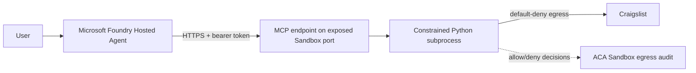

# ACA Sandbox Python Code Interpreter

This sample replaces a built-in agent code interpreter with an authenticated
Model Context Protocol (MCP) server running inside an Azure Container Apps
Sandbox. A Microsoft Foundry Hosted Agent uses the interpreter to retrieve and
analyze current Craigslist listings, while ACA Sandbox egress decisions show
which outbound hosts were allowed or denied.

> [!IMPORTANT]
> ACA Sandboxes and Foundry Hosted Agents include preview capabilities. This
> sample is an engineering demonstration, not a production security baseline.

## Architecture



The deployment creates:

- a Foundry Hosted Agent using the Responses 2.0 protocol;
- a workspace-based Application Insights resource connected to the Foundry project;
- OpenTelemetry traces, logs, GenAI token metrics, and tool-execution metrics;
- an Azure Container Registry containing the interpreter image;
- an ACA Sandbox Group and a single demonstration sandbox;
- a bearer-protected, streamable-HTTP MCP endpoint;
- a default-deny egress policy allowing only Craigslist hosts.

The bearer token is removed from the environment inherited by executed Python
code. The interpreter also applies execution time, output, process, file-size,
and file-descriptor limits.

## Repository layout

```text
.
|-- azure.yaml                  Foundry Hosted Agent manifest
|-- infrastructure/sandbox/    Sandbox and registry infrastructure as Bicep
|-- scripts/                    Deployment, smoke test, and egress inspection
|-- src/
|   |-- agent/                  Foundry Hosted Agent application
|   `-- interpreter/            MCP interpreter image
`-- tests/                      Interpreter unit tests
```

## Prerequisites

- An Azure subscription with ACA Sandboxes enabled.
- Azure CLI 2.60 or later, authenticated with `az login`.
- Azure Developer CLI 1.31 or later.
- The Foundry extension: `azd ext install microsoft.foundry`.
- The ACA early-access CLI available as `aca`.
- PowerShell 7 and Python 3.12 or later.
- Permission to create a resource group, ACR, Sandbox Group, Foundry project,
  model deployment, and role assignments.

## Quickstart

From this directory:

```powershell
pwsh .\scripts\deploy.ps1
```

The script:

1. deploys the resource group, ACR, Sandbox Group, and RBAC;
2. builds the lightweight interpreter image with ACR Tasks;
3. imports it as a Sandbox disk image using a short-lived ACR access token;
4. creates the sandbox, applies default-deny egress, and exposes port `8080`;
5. verifies the MCP server;
6. stores the endpoint and generated token in the local `azd` environment;
7. provisions the Foundry project and connects Application Insights;
8. deploys the instrumented Hosted Agent.

On a successful full redeployment, the script removes the previously recorded
Sandbox only after the new agent version is active.

To use an existing Foundry project instead, initialize this manifest with the
Foundry tooling and set the same `MCP_SERVER_URL` and `MCP_AUTH_TOKEN` values in
the selected `azd` environment before running `azd deploy`.

## Try the agent

Invoke the deployed agent:

```powershell
azd ai agent invoke "Find a few current used bicycles under 500 dollars in Seattle. Compare their prices and include listing URLs."
```

The agent is instructed to use Python for current listing questions and to
include the source listing URLs in its answer.

If the preview `azd ai agent invoke` extension reports an
`AzureDeveloperCLICredential` error, use the included REST-based wrapper:

```powershell
pwsh .\scripts\invoke.ps1 "Find one current used bicycle under 400 dollars in Seattle."
```

## Observability and evaluation

The hosted-agent runtime exports OpenTelemetry telemetry to the Application
Insights resource connected to the Foundry project. Agent Framework adds
GenAI-semantic spans and metrics for model calls and MCP tool execution.
`ENABLE_SENSITIVE_DATA=true` also captures prompts, model responses, tool
arguments, and tool results so they can be inspected in Foundry **Traces**.

> [!WARNING]
> Sensitive telemetry is enabled for this demonstration. It can contain user
> input, generated Python, listing content, and model output. Disable
> `ENABLE_SENSITIVE_DATA` before using the sample with confidential or personal
> data, and apply appropriate RBAC, retention, and regional data controls.

Generate traffic, then summarize tokens, model calls, tool duration, and
captured event types:

```powershell
pwsh .\scripts\invoke.ps1 "Find one current bicycle listing under 400 dollars."
pwsh .\scripts\query-observability.ps1 -LookbackMinutes 30
```

In the Foundry portal, open the project and select **Agents** >
**craigslist-agent** > **Traces**. A trace includes the Responses request,
`invoke_agent`, model `chat`, MCP `execute_tool`, prompt/response events, token
usage, latency, and correlated failures. Application Insights also provides
Live Metrics, transaction search, workbooks, alerts, and KQL queries.

Run the included quality and safety evaluation suite:

```powershell
pwsh .\scripts\run-evaluation.ps1
```

The suite evaluates task adherence, coherence, violence, and a generated
scenario-specific rubric. Its results appear in Foundry **Evaluations**, where
runs can be compared across agent or model versions. The same deployment
telemetry can be used to create trace-based datasets for recurring production
evaluation. Sensitive-data leakage and other adversarial checks belong in a
separate AI Red Teaming Agent run rather than this standard quality suite.

## Inspect egress

```powershell
pwsh .\scripts\show-egress.ps1
```

The output contains the Sandbox allow and deny decisions. To demonstrate a
denial, ask the agent to retrieve a host outside `craigslist.org`, or call the
interpreter directly with code that requests an unapproved domain.

The script reads the Sandbox data-plane REST endpoint directly because some
preview `aca` CLI builds cannot deserialize the current `matchedRule` field.

## Local validation

```powershell
python -m unittest discover -s tests -v
az bicep build --file .\infrastructure\sandbox\main.bicep
```

To smoke-test a deployed MCP endpoint:

```powershell
pwsh .\scripts\smoke-test.ps1
pwsh .\scripts\test-agent-streaming.ps1
```

## Upstream image compatibility

The requested upstream image is:

```text
mcr.microsoft.com/k8se/services/codeinterpreter:0.1.0-python3.12-mcp
```

The deployment script supports it through `-InterpreterImage`. During
validation on August 17, 2026, standalone ACA Sandbox disk import failed in
both Central US and East US 2 with:

```text
ImageBuildFailed: Image build sandbox storage capacity was exceeded while running 'bash'.
```

The image has about 8.5 GB of compressed layers and exceeds the current
standalone Sandbox custom-disk build capacity. The default quickstart therefore
builds the small, source-controlled MCP image in `src/interpreter`. Retry the
upstream image after the service capacity or image layout changes:

```powershell
pwsh .\scripts\deploy.ps1 `
  -InterpreterImage "mcr.microsoft.com/k8se/services/codeinterpreter:0.1.0-python3.12-mcp"
```

The upstream image uses a different MCP tool contract. If its import starts
working, update the Hosted Agent's allowed tool names and instructions to match
the image's `launchShell` and `runPythonCodeInRemoteEnvironment` tools.

## Security limitations

- The Sandbox port is anonymously reachable at the ACA ingress layer because a
  Hosted Agent cannot complete the interactive email-gated port flow. The MCP
  application independently requires a high-entropy bearer token.
- This sample uses one long-lived Sandbox. A production broker should create
  one Sandbox per user, session, or task and delete it afterward.
- Only Craigslist hosts are allowed, but hostname policy is not a substitute
  for content validation, DLP, malware scanning, or private routing.
- The default Hosted Agent identity and the post-deployment entitlement flow
  must be evaluated separately for production.
- Do not place production credentials, tokens, or sensitive data in executed
  code or Sandbox environment variables.

## Troubleshooting

| Symptom | Resolution |
|---|---|
| `ImageBuildFailed` for the upstream interpreter image | Use the default lightweight image or wait for a larger Sandbox image-build capacity. |
| `403` after creating the Sandbox Group | Wait 30-60 seconds for the `Container Apps SandboxGroup Data Owner` role to propagate, then rerun. |
| MCP returns `401` | Ensure `MCP_AUTH_TOKEN` in the Sandbox and the selected `azd` environment are identical. Redeploy both if necessary. |
| MCP connection fails | Confirm the Sandbox is running, port `8080` is exposed, and the endpoint ends in `/mcp`. |
| Craigslist requests are denied | Inspect `show-egress.ps1`; add only the minimum required `craigslist.org` host pattern. |
| No egress decisions appear | Confirm the policy was applied to the current Sandbox ID in `deployment-state.json`. |
| Streaming fails with `AsyncStreamWrapper` missing `parse` | Do not enable `AZURE_EXPERIMENTAL_ENABLE_GENAI_TRACING`; it is incompatible with current Agent Framework streaming. Native Agent Framework telemetry and hosted-agent Application Insights export remain enabled. |
| `azd ai agent` is unavailable | Upgrade `azd`, then run `azd ext install microsoft.foundry`. |
| `azd ai agent invoke` reports `AzureDeveloperCLICredential` | Use `scripts\invoke.ps1`, which obtains the same Foundry token through Azure CLI and calls the Responses endpoint directly. |

## License

Licensed under the [Apache License 2.0](LICENSE).
