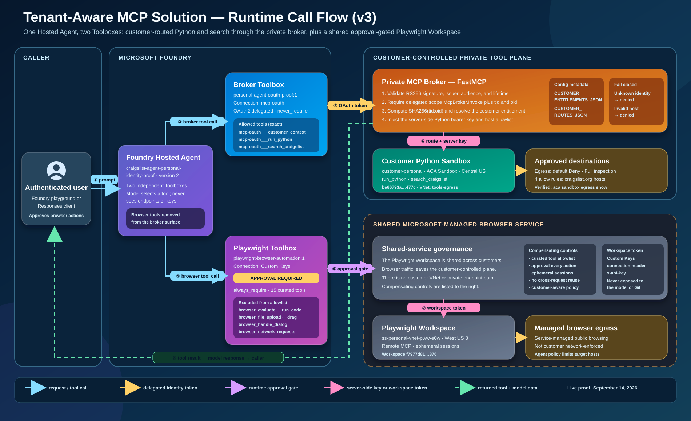
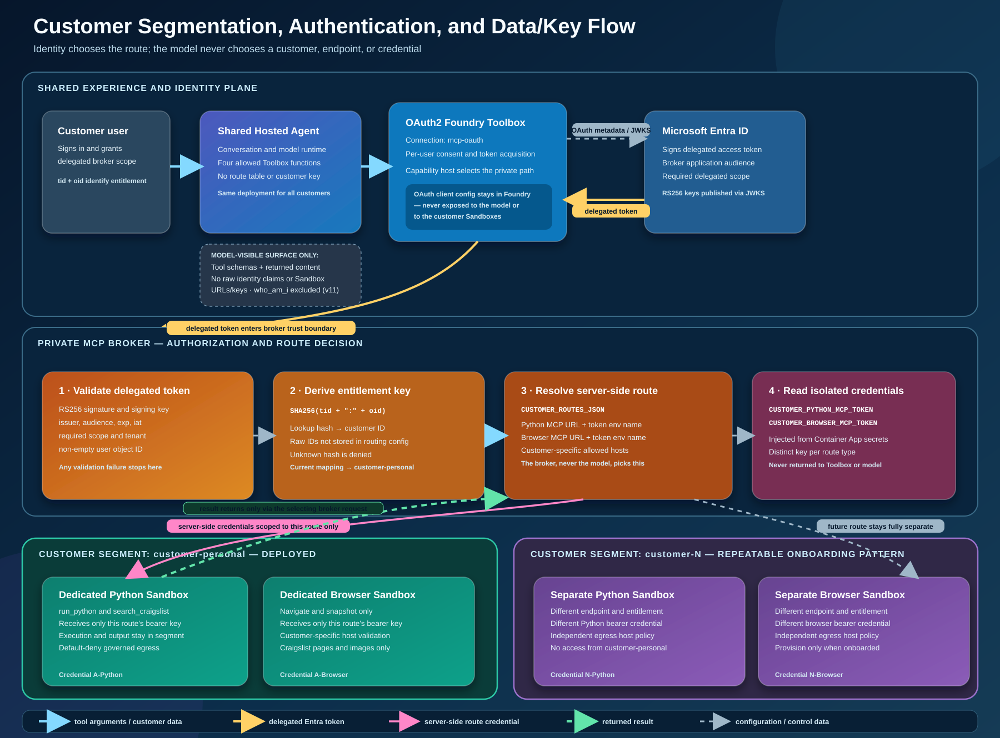
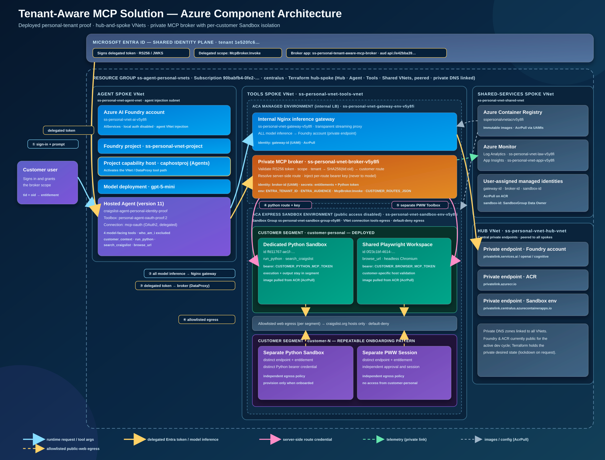

# Tenant-aware MCP solution visuals

These diagrams describe the implemented personal-tenant proof and the
repeatable customer-onboarding pattern. They intentionally prioritize trust
boundaries and ownership over individual Azure resource names.

> The call flow is at revision `-3`, which places the shared Playwright
> Workspace outside the customer-controlled private tool plane. Other diagrams
> are at revision `-2`. Earlier revisions remain for history and are not
> linked below.

## Components and runtime call flow

The shared Hosted Agent uses two Toolboxes. The OAuth2 broker Toolbox exposes
customer context, Python, and search; the broker validates delegated identity
and injects only the selected Python Sandbox credential. The separate PWW
Toolbox connects directly to the shared Playwright Workspace remote MCP,
exposes a curated browser allowlist, and requires runtime approval for every
browser action.

The `-3` revision makes the trust boundary explicit: the Playwright Workspace
is a shared Microsoft-managed service that sits outside the customer-controlled
private tool plane. Browser separation therefore rests on the exact tool
allowlist, per-action runtime approval, ephemeral non-reused sessions, and
agent policy — not on VNet or private endpoint isolation. The Python Sandbox
path is unchanged and remains network-isolated with default-deny egress.

## Customer segmentation, authentication, and data/key flow

The security boundary is the broker:

- `tid` and `oid` are read only from the validated delegated token.
- `SHA256("<tenant-id>:<object-id>")` selects an entitlement without storing
  raw identity IDs in the routing configuration.
- The entitlement selects a customer route containing the Python MCP endpoint,
  its secret environment-variable name, and approved Craigslist hosts.
- The Python bearer credential remains server-side in the broker.
- The model cannot choose a customer, endpoint, credential, or allowed host.
- PWW is shared across customers; separation relies on customer-specific
  delegated principals/tokens where supported, exact tool allowlisting,
  per-action approval, and non-reused browser sessions rather than a
  per-customer VNet or private endpoint.
- `customer-personal` is deployed. `customer-N` illustrates the same isolated
  onboarding pattern and is not presented as an additional deployed customer.

The active proof uses Hosted Agent version `2`, broker Toolbox
`personal-agent-oauth-proof:1`, PWW Toolbox
`playwright-browser-automation:1`, connection `mcp-oauth`, one dedicated
`customer-personal` Python Sandbox, and shared Workspace
`ss-personal-vnet-pww-e0w`.

## Full Azure component architecture

A resource-level view of the deployed personal-tenant proof in resource group
`ss-agent-personal-vnets` (`centralus`). It maps the hub-and-spoke VNets and the
concrete Azure services behind the flow above:

- **Agent spoke** — Azure AI Foundry account/project, the project capability
  host `caphostproj` that activates the VNet/DataProxy tool path, the
  `gpt-5-mini` deployment, and the Hosted Agent with its OAuth2 Toolbox.
- **Tools spoke** — the ACA managed environment (internal load balancer) hosting
  the internal Nginx inference gateway and the private MCP broker Container App,
  plus the ACA Express Sandbox environment hosting the per-customer Python
  Sandbox.
- **Managed browser service** — the shared West US 3 Playwright Workspace and
  its project-scoped Custom Keys connection; this path is outside the customer
  VNet and private broker route.
- **Shared-services spoke** — Azure Container Registry, Azure Monitor
  (Log Analytics + Application Insights), and the user-assigned managed
  identities (`gateway-id`, `broker-id`, `sandbox-id`) that hold `AcrPull`.
- **Hub** — the central private endpoints for Foundry, ACR, and the Sandbox
  environment, with private DNS zones linked to every spoke.

All model inference flows through the internal Nginx gateway. Broker tool calls
travel the OAuth2 Toolbox/DataProxy path and remain customer-routed; PWW calls
travel through the separate direct Toolbox. The current live canary uses
`network_access_mode=playground` so the Foundry Playground and deployment APIs
remain accessible. Set `network_access_mode=private` for final lockdown.
