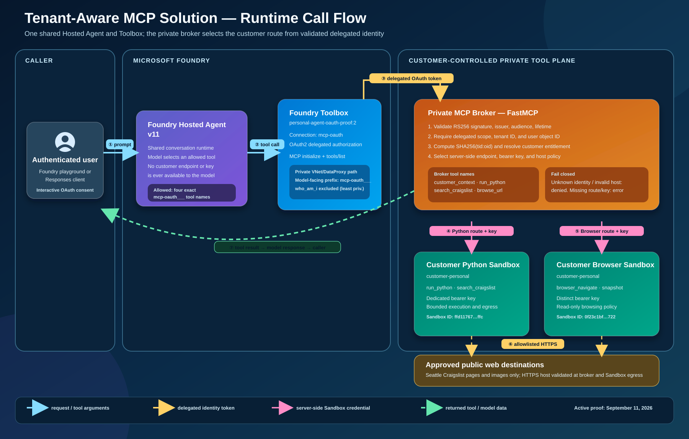

# Tenant-aware MCP solution visuals

These diagrams describe the implemented personal-tenant proof and the
repeatable customer-onboarding pattern. They intentionally prioritize trust
boundaries and ownership over individual Azure resource names.

> The `-2` files are the current revision (tighter spacing, no overlapping
> labels). The original files remain for history and are not linked below.

## Components and runtime call flow

The shared Hosted Agent exposes only four exact Toolbox function names. The
OAuth2 Toolbox sends a delegated broker token over the private DataProxy path.
The broker validates the token, derives the customer entitlement, and injects
only the selected route's server-side Sandbox credential. Tool output returns
through the same broker request and becomes model response content.

## Customer segmentation, authentication, and data/key flow

The security boundary is the broker:

- `tid` and `oid` are read only from the validated delegated token.
- `SHA256("<tenant-id>:<object-id>")` selects an entitlement without storing
  raw identity IDs in the routing configuration.
- The entitlement selects a customer route containing MCP endpoints, secret
  environment-variable names, and approved hosts.
- Distinct Python and browser bearer credentials are injected from Container
  App secrets and remain server-side.
- The model cannot choose a customer, endpoint, credential, or allowed host.
- `customer-personal` is deployed. `customer-N` illustrates the same isolated
  onboarding pattern and is not presented as an additional deployed customer.

The active proof uses Hosted Agent version `11`, Toolbox
`personal-agent-oauth-proof:2`, connection `mcp-oauth`, and the dedicated
`customer-personal` Python and browser Sandboxes.

## Full Azure component architecture

A resource-level view of the deployed personal-tenant proof in resource group
`ss-agent-personal-vnets` (`centralus`). It maps the hub-and-spoke VNets and the
concrete Azure services behind the flow above:

- **Agent spoke** — Azure AI Foundry account/project, the project capability
  host `caphostproj` that activates the VNet/DataProxy tool path, the
  `gpt-5-mini` deployment, and the Hosted Agent with its OAuth2 Toolbox.
- **Tools spoke** — the ACA managed environment (internal load balancer) hosting
  the internal Nginx inference gateway and the private MCP broker Container App,
  plus the ACA Express Sandbox environment hosting the per-customer Python and
  browser Sandboxes.
- **Shared-services spoke** — Azure Container Registry, Azure Monitor
  (Log Analytics + Application Insights), and the user-assigned managed
  identities (`gateway-id`, `broker-id`, `sandbox-id`) that hold `AcrPull`.
- **Hub** — the central private endpoints for Foundry, ACR, and the Sandbox
  environment, with private DNS zones linked to every spoke.

All model inference flows through the internal Nginx gateway to the Foundry
private endpoint; tool calls travel the OAuth2 Toolbox/DataProxy path to the
broker, which injects per-route Sandbox bearer keys server-side. Foundry and ACR
are intentionally public for the active development cycle while Terraform retains
the private desired state.
